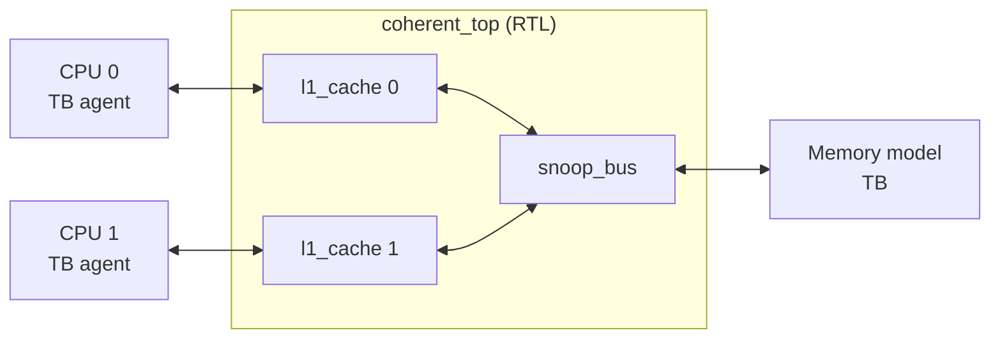

# Coherent Cache & Memory Subsystem

Two write-back L1 data caches kept coherent with MESI over an atomic snooping bus, written in synthesizable SystemVerilog and verified with a UVM testbench: constrained-random stimulus against a reference model, SVA protocol checks, functional coverage and mutation testing.

## Stages

| # | Adds | Status |
| --- | --- | --- |
| 0 | Architecture spec, package, memory model, handshake assertions | In progress |
| 1 | Direct-mapped read path, reference model | – |
| 2 | Write-back, write-allocate, byte strobes, dirty eviction | – |
| 3 | 2-way set associative, LRU | – |
| 4 | UVM environment, coverage, mutation testing | – |
| 5 | Synthesis of `l1_cache` | – |
| 6 | Two caches, atomic snooping bus, MSI | – |
| 7 | E state, race handling, coherence stress | – |
| 8 | Performance counters, false-sharing demo | – |
| 9 | Nexys A7-100T board demo | – |

## Docs

- [Architecture](docs/architecture.md)
