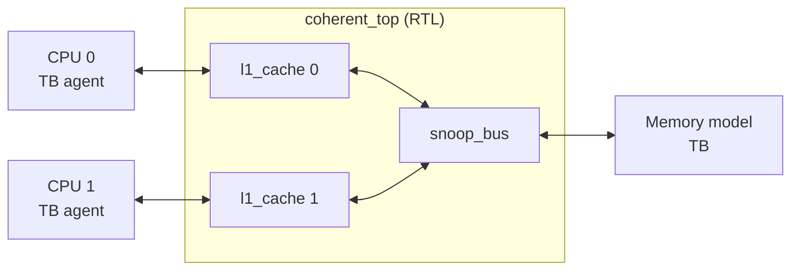

# Coherent Cache & Memory Subsystem

Two write-back L1 data caches kept coherent with MESI over an atomic snooping bus, written in synthesizable SystemVerilog and verified with a UVM testbench: constrained-random stimulus against a reference model, SVA protocol checks, functional coverage and mutation testing.



## Stages

| # | Adds | Status |
| --- | --- | --- |
| 0 | Architecture spec, package, memory model, handshake assertions | Done |
| 1 | Direct-mapped read path, reference model | Done |
| 2 | Write-back, write-allocate, byte strobes, dirty eviction | Done, in review |
| 3 | 2-way set associative, LRU | – |
| 4 | UVM environment, coverage, mutation testing | – |
| 5 | Synthesis of `l1_cache` | – |
| 6 | Two caches, atomic snooping bus, MSI | – |
| 7 | E state, race handling, coherence stress | – |
| 8 | Performance counters, false-sharing demo | – |
| 9 | Nexys A7-100T board demo | – |

## Results

| Stage | Regression |
| --- | --- |
| 0 | 13/13 runs pass: package test at `WAYS` = 1, 2; memory model test, 3 configs × 3–5 seeds |
| 1 | 24/24 runs pass. Loads: 3,008 per run, 0 mismatches, 3 memory configs × 3–5 seeds. 8/8 planted RTL bugs caught |
| 2 | 30/30 runs pass. 3,017 requests per run (40%, 0% and 100% stores), 0 mismatches, every WriteBack checked for address and data, all 15 strobe patterns covered. 11/11 planted bugs caught |

## How to Run

Requires Vivado 2025.2 (xsim) and bash (Git Bash on Windows). The scripts find Vivado through `VIVADO_BIN`, then `PATH`, then the default Windows install.

```
sim/regress.sh                                   # full regression
sim/run.sh -t tb_mem_model -s 7 -p MAX_LAT=20    # one test, seed 7, one plusarg
sim/run.sh -t tb_l1 -s 3 -p STORE_PCT=100        # L1 test, stores only
```

Logs are written to `sim/out/<build>/seed_<n>.log`.

## Docs

- [Architecture](docs/architecture.md)
- [Verification](docs/verification.md)
- [Bug log](docs/bugs.md)
