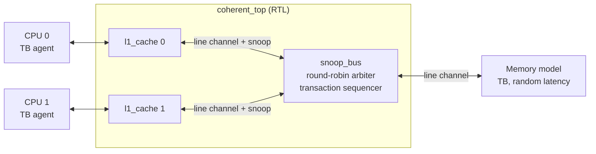
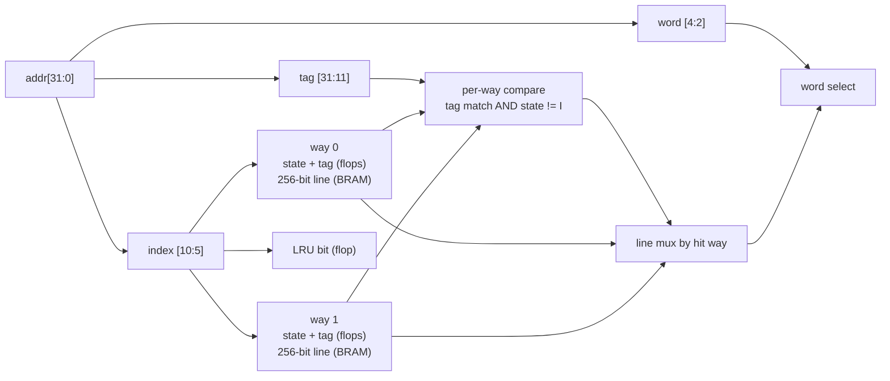
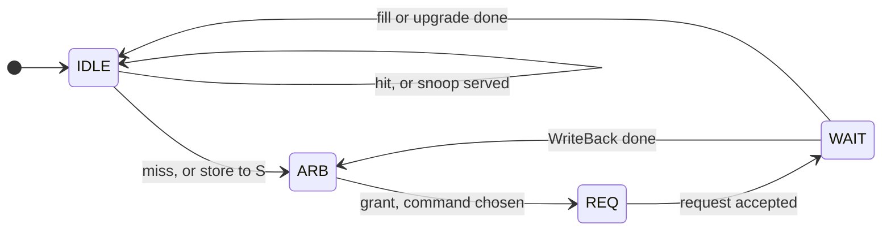
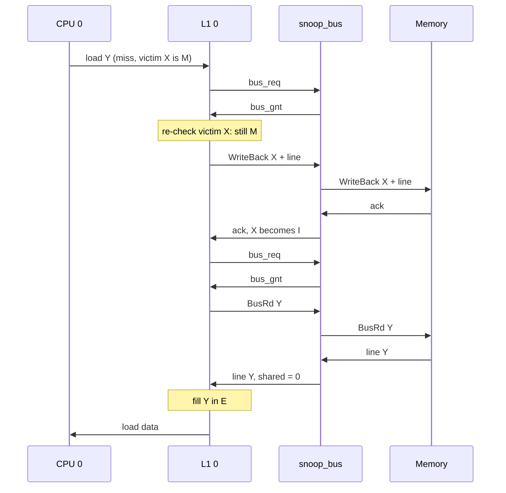
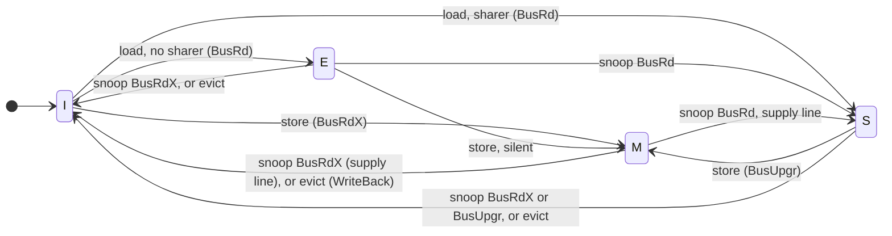
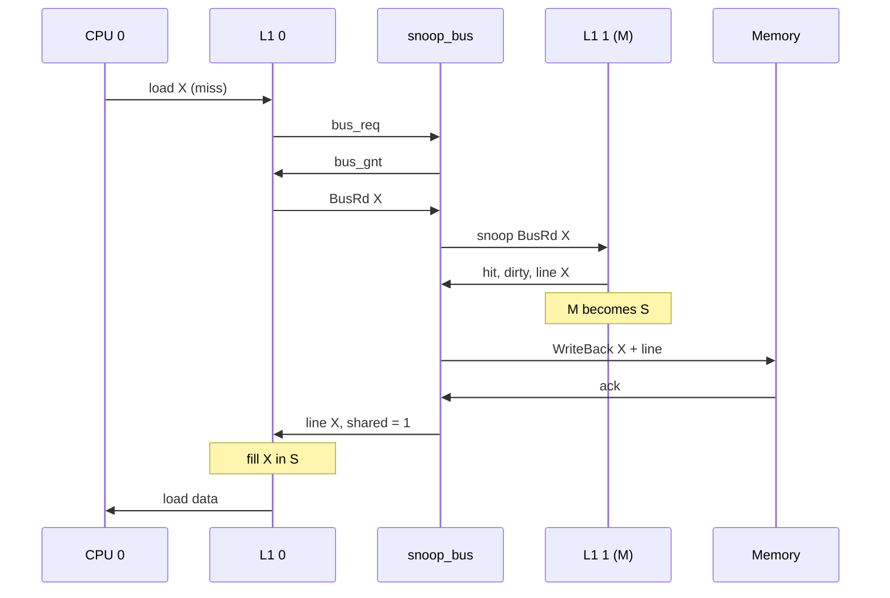

# Architecture

Target design for the finished system. Sections for parts that are not built yet are marked with the stage that builds them.

## Overview

> Planned (Stage 6)

Two L1 data caches, one per CPU, share memory through an atomic snooping bus. MESI keeps their copies coherent. The CPUs and the memory are testbench models; everything inside `coherent_top` is synthesizable.

Stages 1–5 build and verify one `l1_cache` connected directly to the memory model. Stage 6 places two caches behind `snoop_bus`. The cache's memory-side port is the same line channel in both builds, so the miss path is written once.

| Module | Role | Why it is a separate module |
| --- | --- | --- |
| `cache_pkg` | Parameters, types, MESI and bus command enums, address helpers | One source for every size; no magic numbers |
| `tag_array` | Tags, line state, LRU bits (flops) | Pure storage. Coherence changes the controller, not storage |
| `data_array` | Line data, true dual-port block RAM | Isolates RAM inference so synthesis maps it predictably |
| `cache_ctrl` | Controller FSM: lookup, victim, miss path, snoop response | All policy in one place |
| `l1_cache` | Cache top: arrays + controller | The unit that is verified and synthesized alone |
| `snoop_bus` | Arbiter, transaction sequencing, memory master | The only shared block; a cache never needs to know its peer |
| `coherent_top` | Two caches + bus | System top for Stages 6–9 |

## Parameters and Address Breakdown

| Parameter | Value | Derived |
| --- | --- | --- |
| `ADDR_W` | 32 | |
| `WORD_W` | 32 | `STRB_W` = 4 |
| `LINE_BYTES` | 32 | `LINE_W` = 256, `WORDS_PER_LINE` = 8, `OFFSET_W` = 5 |
| `SETS` | 64 | `INDEX_W` = 6 |
| `WAYS` | 2 | `TAG_W` = 32 − 6 − 5 = 21 |

| Field | Bits | Width | Selects |
| --- | --- | --- | --- |
| tag | `[31:11]` | 21 | Which memory line occupies a way |
| index | `[10:5]` | 6 | One of 64 sets |
| word | `[4:2]` | 3 | One of 8 words in the line |
| byte | `[1:0]` | 2 | Always 0 on the CPU port; stores use byte strobes |

| Storage | Size per cache | Implementation |
| --- | --- | --- |
| Data | 2 × 64 × 256 bit = 4 KiB | Block RAM, registered read, byte write enables |
| Tags | 2 × 64 × 21 bit | Flops |
| State | 2 × 64 × 2 bit | Flops |
| LRU | 64 × 1 bit | Flops |

### Line State
Each way stores a 2-bit `{I, S, E, M}` state instead of separate valid and dirty bits. `valid = (state != I)`, `dirty = (state == M)`. An illegal "dirty but invalid" combination cannot be encoded. A single cache never uses S: a fill sets E, a store sets M.

### Tags in Flops, Data in BRAM
Tags are compared combinationally in the cycle a request is accepted, so the hit way is known before the data array output arrives. Both ways are read in parallel and the hit way selects the line one cycle later. Tags in BRAM would add a cycle before the compare.

## Interfaces

> CPU port stores (`we`, `wdata`, `strb`): Planned (Stage 2). Bus and snoop ports: Planned (Stage 6).

RTL modules use plain ports. The testbench wraps them in SystemVerilog interfaces.

### CPU Port (per cache)

| Signal | Dir | Meaning |
| --- | --- | --- |
| `cpu_req_valid` | in | Request present |
| `cpu_req_ready` | out | Cache can accept |
| `cpu_req_we` | in | 1 = store, 0 = load |
| `cpu_req_addr[31:0]` | in | Word-aligned byte address |
| `cpu_req_wdata[31:0]` | in | Store data |
| `cpu_req_strb[3:0]` | in | Store byte enables |
| `cpu_resp_valid` | out | One-cycle pulse; loads and stores both get one |
| `cpu_resp_rdata[31:0]` | out | Load data |

The cache accepts at most one request until it responds. It can accept the next request in the same cycle it returns a response, so back-to-back hits complete one per cycle. The response has no ready: a CPU with one request in flight always has room for its answer.

### Line Channel (cache ↔ memory, cache ↔ bus, bus ↔ memory)

| Signal | Dir (master) | Meaning |
| --- | --- | --- |
| `req_valid` / `req_ready` | out / in | Request handshake |
| `req_cmd` | out | `BusRd`, `BusRdX`, `BusUpgr`, `WriteBack` |
| `req_addr[31:5]` | out | Line address |
| `req_wdata[255:0]` | out | Line data for `WriteBack` |
| `resp_valid` / `resp_ready` | in / out | Response handshake |
| `resp_rdata[255:0]` | in | Line data for reads |
| `resp_shared` | in | Another cache holds the line (E vs S on fill). Memory drives 0 |

- Both channels follow AXI handshake rules: `valid` does not depend on `ready`, `valid` stays high until the handshake, and the payload holds stable while `valid && !ready`.
- One request outstanding. Every request gets exactly one response; a `WriteBack` response carries no data.
- A full line moves in one beat. Bursts would add beat counters to every master and slave without teaching anything about caching.
- Memory treats `BusRd` and `BusRdX` as reads and `WriteBack` as a write. `BusUpgr` never reaches memory.

### Bus Port (Stage 6)

| Signal | Dir (cache) | Meaning |
| --- | --- | --- |
| `bus_req` | out | Cache needs a bus transaction |
| `bus_gnt` | in | Cache owns the bus until its response |

The cache drives the line channel only while it holds `bus_gnt`. It picks the command after the grant arrives, not when it raises `bus_req` (see [Races](#races)). This is why arbitration is a separate request/grant pair: an AXI-style request could not change its command while waiting.

### Snoop Port (Stage 6)

| Signal | Dir (cache) | Meaning |
| --- | --- | --- |
| `snoop_valid` | in | Snoop present |
| `snoop_cmd` | in | `BusRd`, `BusRdX`, `BusUpgr` |
| `snoop_addr[31:5]` | in | Line address |
| `snoop_resp_valid` | out | Exactly one cycle after `snoop_valid` |
| `snoop_hit` | out | Line was valid here |
| `snoop_dirty` | out | Line was M; `snoop_rdata` is valid |
| `snoop_rdata[255:0]` | out | Line data, read on data array port B |

Snoops have fixed latency and no ready. They win the tag lookup over the CPU (the CPU stalls one cycle) and read data on their own RAM port, so nothing can delay them.

## Cache Controller

> Planned (Stage 2: store hits and WriteBack. Stage 6: ARB)

Stages 1–5 have no bus: IDLE goes straight to REQ, and a finished WriteBack returns to REQ for the fill.

| State | Action |
| --- | --- |
| IDLE | Serve a snoop if present. Otherwise accept a CPU request and compare tags. A hit completes here; a miss leaves IDLE. |
| ARB | Hold `bus_req`. On grant, re-read the state of the target line and the victim and choose the command. |
| REQ | Hold `req_valid` with the chosen command until accepted. |
| WAIT | Wait for the response. After a WriteBack, the victim becomes I and the fill follows. After a fill or upgrade, write the line, set state and LRU, and respond next cycle. |

### Hits
A hit updates data, state and LRU at the end of its accept cycle. The next request, accepted one cycle later, sees those updates, so back-to-back hits need no forwarding.

| Cycle | Load hit | Store hit (E or M) |
| --- | --- | --- |
| 0 | Accept, compare tags, read both ways, update LRU | Accept, compare tags, write word with byte enables, state → M, update LRU |
| 1 | Mux line by hit way, select word, `cpu_resp_valid` | `cpu_resp_valid` |

A store to an S line is not a hit for writing: it needs `BusUpgr`.

### Command Choice

| Condition at the moment of choosing | Command |
| --- | --- |
| Miss and victim is M | `WriteBack` of the victim, then the fill |
| Load miss | `BusRd` |
| Store miss | `BusRdX` |
| Store to a line still in S | `BusUpgr` |
| Store to a line that was S but is now I | `BusRdX` |
| Victim was M but is now S or I | No WriteBack; go straight to the fill |

## Write Policy and Eviction

> Planned (Stage 2)

### Write-Back, Write-Allocate
A store hit updates only the cache and sets M. A store miss fetches the line with `BusRdX`, merges the store bytes into the returned line and writes the whole line once, ending in M.

### Byte Strobes
The data array has one write enable per byte (32 per line). A store shifts its 4-bit strobe to the word position given by `addr[4:2]`.

### Dirty Eviction
If the selected victim contains modified data, memory is stale. The cache therefore writes the victim line back before requesting the new one. The victim stays in the array until the WriteBack is issued; there is no writeback buffer. A snoop that arrives while the cache waits for the bus finds the line in the array as usual. The cost is one extra memory round trip on every dirty miss.

## Replacement

> Planned (Stage 3)

The victim is the first invalid way; if every way is valid, the LRU way. One bit per set names the least recently used way and flips on every hit and fill. Snoops do not touch LRU: they are not uses by this cache's CPU. `WAYS` is a parameter; `WAYS = 1` is direct-mapped with no LRU state. A 4-way build would use tree-PLRU (3 bits per set).

## Coherence

> Planned (Stage 6: MSI. Stage 7: E state and races)

### MESI States

| State | Valid | Dirty | Other cache may hold it | Store without bus |
| --- | --- | --- | --- | --- |
| M | yes | yes | no | yes |
| E | yes | no | no | yes (→ M) |
| S | yes | no | yes, in S | no (`BusUpgr`) |
| I | no | – | – | – |

Hits stay in their state and are omitted.

### Bus Transactions

| Command | Issued for | Peer action | Data source | Requester ends in |
| --- | --- | --- | --- | --- |
| `BusRd` | Load miss | M → S (supplies line, memory updated); E → S; S stays S | Peer if it was M, else memory | S if peer hit, else E |
| `BusRdX` | Store miss, lost upgrade | Any → I (M supplies line) | Peer if it was M, else memory | M |
| `BusUpgr` | Store to S | S → I | None | M |
| `WriteBack` | Dirty eviction | Not snooped | Requester → memory | Victim → I |

- **Memory is updated on `BusRd` from an M peer.** Both copies end clean in S, so neither needs a writeback later. Avoiding that write needs an Owned state (MOESI), which is out of scope.
- **Memory is not updated on `BusRdX` from an M peer.** The requester ends in M, so memory would be stale again at once.
- **`WriteBack` is not snooped.** A line in M has no other copy.

### Atomic Bus
The bus serves one transaction at a time, from grant to response. A cache never sees a snoop for a line while its own transaction is on the bus, so no transient states are needed. The cost is no overlap between transactions. The round-robin arbiter gives priority to the other cache after each grant, so neither cache can starve.

### Read From a Modified Peer

### Races
Both races are handled by one rule: **the controller chooses its bus command when the grant arrives, from the state at that moment, not when it raised `bus_req`.**

| Race | While waiting for the grant | Found at grant | Command issued | Without the re-check |
| --- | --- | --- | --- | --- |
| Upgrade loses the bus | Peer's `BusRdX` or `BusUpgr` invalidates our S line | Line is I | `BusRdX` instead of `BusUpgr` | The cache writes into a stale line and claims M: the peer's store is lost |
| Snoop during dirty eviction | Peer's `BusRd` (victim M → S) or `BusRdX` (victim → I) | Victim not M | Skip WriteBack, issue the fill | The cache writes back a line it no longer owns |

### Invariants
- **SWMR:** if one cache holds a line in M or E, the other holds it in I.
- At most one way hits per lookup; no set holds the same tag twice.
- Exactly zero or one cache holds `bus_gnt`.

## Performance Counters

> Planned (Stage 8)

Per cache: hits, misses, writebacks, upgrades, snoops received, invalidations received. Bus: transactions per command, busy cycles. These drive the false-sharing comparison.

## Board Demo

> Planned (Stage 9)

`coherent_top` on a Nexys A7-100T at 100 MHz. Two synthesizable traffic generators replace the CPU agents. A BRAM memory implements the line channel with fixed latency. A switch selects true sharing (both CPUs write the same word) or false sharing (different words in the same line) or no sharing (different lines). The 7-segment display shows bus transactions and invalidations for the selected run.

## Reset
Synchronous, active-high `rst`. Every line state goes to I, every LRU bit to 0, and the controller and bus to idle. The data array is not reset: block RAM cannot be, and an I line is never read.
