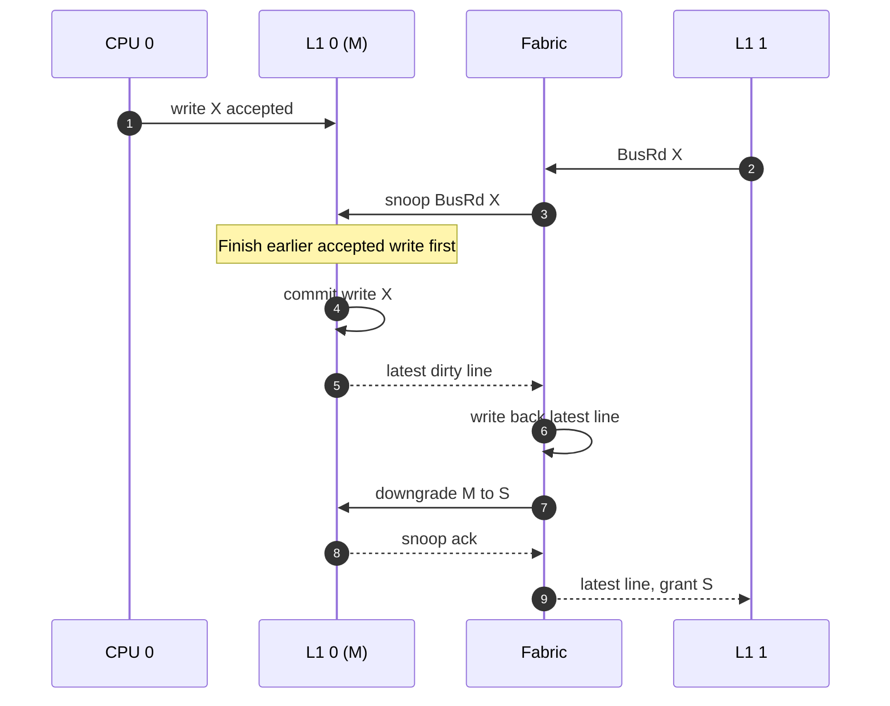

# Coherence ordering

The fabric handles one bus transaction at a time, but local cache hits can happen without using that bus. We still need rules for a store and a snoop that target the same line.

## Our rules

1. If a snoop and a **new** CPU request arrive together, handle the snoop first.
2. If a store was **already accepted**, finish its update before replying to a conflicting snoop. An accepted request cannot simply disappear.
3. Hold the affected line busy while resolving a snoop or ownership change.
4. Do not grant write ownership until the other cache has acknowledged any required invalidation or writeback.
5. If a Shared line changes while a `BusUpgr` is waiting, check its tag and state again before writing. If it is no longer Shared, retry as a miss.

## Example: a local store races with another cache's read

The important part is the **order**: the earlier accepted store finishes before the peer gets data. Otherwise, the peer could receive stale data even though its read came after the store.

For the same line, stable pairs such as **M/S**, **M/M**, and **E/S** are illegal. **S/S** is legal. We use writeback-before-sharing for an M owner, which makes both Shared copies clean but adds traffic.
