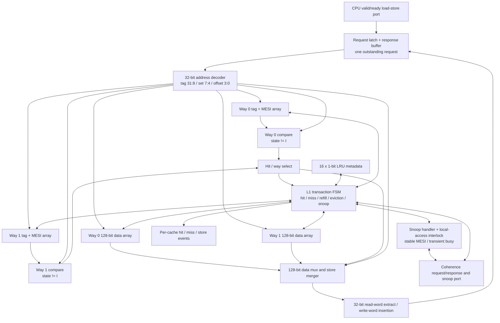

# Inside one L1 cache

Both L1s use the same hardware. Each has **16 sets with two ways per set**, and each way can hold a 16-byte line. A read compares the requested tag against both ways in the selected set.

## Where the address goes

A CPU address is 32 bits. We split it like this:

| Bits | Name | Why |
| --- | --- | --- |
| `[31:8]` | Tag (24 bits) | Identifies which memory line is stored |
| `[7:4]` | Set index (4 bits) | Selects one of 16 sets |
| `[3:0]` | Byte offset (4 bits) | Finds the requested byte within a 16-byte line |

Only aligned 32-bit operations are supported, so `addr[1:0] = 00`; `addr[3:2]` selects one of the four words in a line.

## What's stored in each cache

| Storage | Size |
| --- | ---: |
| Data | 2 ways × 16 sets × 128 bits = **512 B** |
| Tags | 2 × 16 × 24 = 768 bits |
| MESI metadata | 2 × 16 × 2 = 64 bits |
| LRU metadata | 1 bit per set = 16 bits |

**Why two ways?** Two different addresses can occupy the same set. A direct-mapped cache would have to evict one immediately. Two ways reduce those conflicts without making the design much larger.

**Why LRU?** When both ways are occupied, the controller replaces the one used least recently. With only two ways, that takes a single bit per set. An invalid way is always preferred over evicting a valid one.

**Why keep MESI with each tag?** The tag says *which* line this is; the MESI bits say *whether it can be used, shared, or written*. State **I** already means invalid, and **M** already means dirty, so we do not need separate valid or dirty bits.

The FSM handles misses, refills, writebacks, and snoops. A hit uses the selected word; a miss brings in an entire line. See [coherence ordering](coherence_ordering.md) for conflicts between a local request and a snoop.
