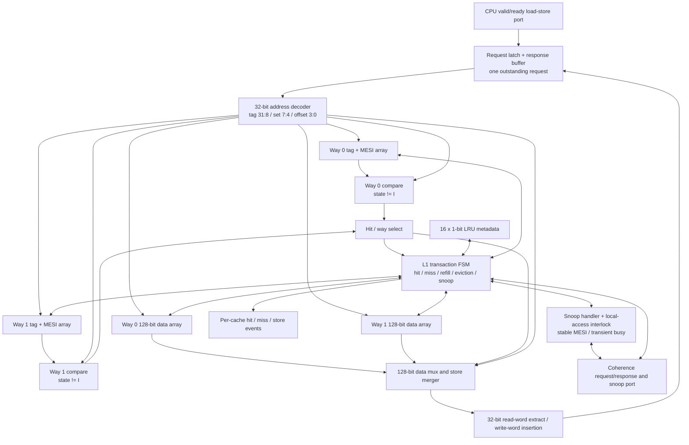

# L1 Data-Cache Microarchitecture (one of two identical caches)

**Document:** L1-001 | **Version:** 0.2 | **State:** Proposed final microarchitecture

This is the detailed hardware blueprint for **one** L1. Two instances are connected to a shared coherence fabric. The L1 is synthesizable; stimulus generators and memory models are not part of it.

## Block diagram

## Parameters / storage budget

| Field | Per way / set | Overall per L1 |
| --- | --- | --- |
| 128-bit line data | 16 lines per way | 2 × 16 × 128 = 4096 bits / **512 B** data |
| Tag | 24 bits per line | 2 × 16 × 24 = 768 tag bits |
| MESI state | 2 bits per line | 2 × 16 × 2 = 64 state bits |
| LRU | 1 bit per set | 16 LRU bits |

Data total **does not include** tag, state, LRU or control registers. A line is valid exactly when `MESI != I`; there is no separate valid bit. There is no separately stored dirty bit because `M` indicates dirty data for this protocol.

**Address fields:** `tag = addr[31:8]`, `set = addr[7:4]`, `line_offset = addr[3:0]`, word index `addr[3:2]`; request addresses are aligned (`addr[1:0] == 2'b00`). Line base address is `{addr[31:4], 4'b0000}`. Little-endian word accesses.

## Datapath design

1. **Request latch / response buffer**: accepts a CPU request when idle and not blocked by snoop priority; returns one 32-bit read response or a write acknowledgement.
2. **Address decoder**: extracts tag, set, word index and aligned line address.
3. **Way tag + MESI arrays**: two selected entries per set are checked. A hit means tag matches **and MESI is not I**. Both ways matching the same line while valid is a design error.
4. **Two 128-bit data arrays**: supply line data for a load; accept full-line refills, store-word updates and snoop/writeback reads. Byte lanes/unaligned requests are outside the target scope.
5. **Compare and select**: select the single hit way or request a miss/replacement; extract the requested 32-bit word from the selected line.
6. **LRU controller**: per-set 1-bit victim selector when both ways valid; use an invalid way first. On completed CPU access/fill, mark the accessed way most-recently-used (so the opposite is LRU).
7. **Transaction/controller FSM**: performs hits, miss fetch, 2-way replacement, dirty victim writeback, refill, ownership upgrade, response and retry logic.
8. **Snoop handler/interlock**: matches incoming snoops, arbitrates against local hits, supplies latest Modified data, and gates state changes until grants/writebacks complete.
9. **Performance events**: L1 emits local hit/miss/store counters; bus separately counts coherence traffic (avoids missing events that never use the bus).

## Request and miss paths

| Case | Planned controller action |
| --- | --- |
| Read hit S/E/M | Select line and word; respond; update LRU; **no memory access** |
| Write hit M/E | Modify selected word; E becomes M; respond only after committed local update |
| Write hit S | Request `BusUpgr`, wait for invalidation/grant, recheck state, update word, set M |
| Read miss | Choose invalid way or LRU victim, flush victim M if present; issue `BusRd`; install full line as E or S per snoop result; respond |
| Write miss | Choose victim, flush M victim; issue `BusRdX`, receive latest line / grant, apply store, install as M; respond |
| Dirty victim eviction | Write back its full 128-bit line before allowing target way overwrite |
| Peer snoop BusRd | Return clean hit or current dirty data; M owner completes writeback before M→S; E→S |
| Peer ownership snoop | Invalidate E/S or flush and invalidate M; **ack only after** required update/flush |
| Simultaneous snoop/local op | Snoop-priority gate for new requests; drain accepted older op; hold correct line data until ack |

## Critical controller states (illustrative, not MESI states)

`IDLE`, `LOOKUP`, `HIT_UPDATE`, `SELECT_VICTIM`, `EVICT_WB_REQ`, `EVICT_WB_WAIT`, `COH_REQ`, `WAIT_GRANT`, `REFILL`, `SNOOP_HOLD`, `SNOOP_WB`, `RESPONSE`, `RETRY`.

A synchronous BRAM implementation may need additional lookup/read cycles; ready/valid allows this without changing functional behavior. The diagram does not assume a combinational BRAM read. Details of how a single-port or dual-port data array shares CPU and snoop accesses are an implementation choice; **snoop/local conflict handling must be implemented**.

## Verification checkpoints for this module

- The tag/index/offset mapping hits the intended set and word.
- A single tag comparison and exactly one legal matching way is selected.
- Invalid way chosen before LRU victim; both ways retained when appropriate.
- Dirty victim data appears at memory **before** its tag/data is replaced.
- S→M updates only after ownership, including queued-upgrade invalidation race.
- A local M/E store hit cannot race past a pending conflicting snoop.
- Internal state reports and actual data match expected values after accepted CPU operations.

See [`coherence_ordering.md`](coherence_ordering.md) for the formal concurrency rules.
