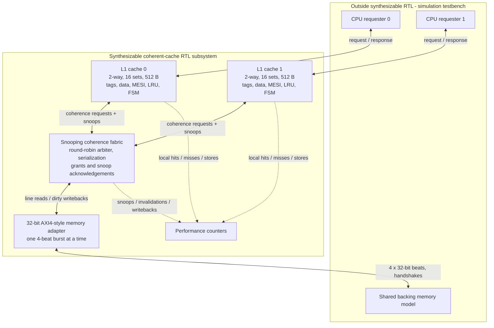
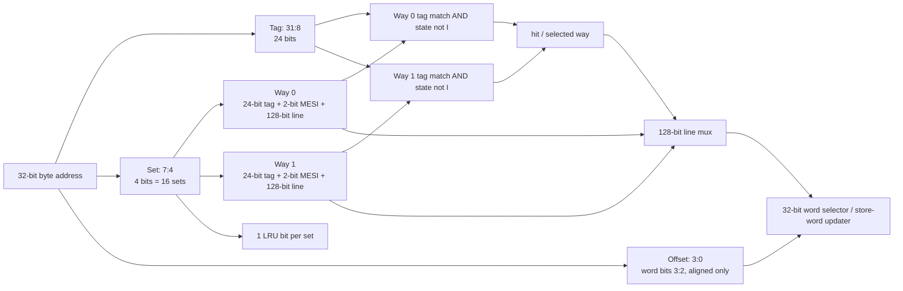

# System Architecture Specification

**Document:** ARCH-001 | **Version:** 0.2 | **State:** Proposed final architecture | **Date:** 2026-10-18

## 1. Purpose and scope

Implement a coherent, dual-L1 data-cache memory subsystem in synthesizable SystemVerilog; verify with a standalone SystemVerilog/UVM environment; synthesize and analyze timing on the Nexys A7-100T. This document defines the **end goal**; implementation phases do not need separate architecture diagrams.

## 2. System block diagram



**Boundary:** the requesters and backing-memory model are testbench components during RTL simulation. Both L1 controllers, snooping fabric, memory adapter, and performance counters are intended to be synthesizable. To run the entire subsystem *on the FPGA*, add a synthesizable memory slave (e.g. BRAM) and synthesizable test stimulus; synthesis of the cache RTL alone is not an on-board functional demo.

## 3. Configuration and cache organization

| Item | Planned final configuration |
| --- | --- |
| Number of CPUs / caches | Two requesters, two private L1 data caches |
| Address format | 32-bit byte addresses, little-endian data |
| CPU accesses | Aligned 32-bit loads and stores; one outstanding request per CPU |
| L1 associativity | 2-way, 16 sets |
| Line size | 16 bytes = four 32-bit words |
| Cache size | 16 sets × 2 ways × 16 bytes = **512 bytes per L1** |
| Tag | address[31:8], 24 bits |
| Set | address[7:4], 4 bits |
| Byte offset | address[3:0], 4 bits (word-select from bits [3:2]) |
| Replacement | 1-bit true LRU within each 2-way set |
| Write policy | Write-back and write-allocate |
| Coherence | MESI, central snooping and transaction serialization |
| Memory transactions | 16-byte line reads/writes as four 32-bit beats |
| Clock/reset | One synchronous clock domain; synchronous active-low reset (planned) |
| Backpressure | Valid/ready-style handshakes; no dropped accepted request |
| Throughput | One outstanding request per requester; no general-purpose OoO engine |



Cache line metadata per way consists of tag, MESI state and data; one LRU bit is maintained per set. An invalid line is represented by state I, removing the need for an independent valid bit. State and tag update are logically atomic at the serialized commit boundary. Per-line metadata is described in [`l1_microarchitecture.md`](l1_microarchitecture.md).

## 4. RTL component responsibilities

| Component | Purpose |
| --- | --- |
| `cache_subsystem_top` | Connect requesters, two cache controllers, coherence fabric and memory adapter |
| `l1_cache` ×2 | Detect hits/misses, update words, allocate/replace lines, arbitrate local accesses vs snoops and respond to CPU requests |
| `cache_tag_data_array` | Store tag, 128-bit data and MESI metadata for 2 ways × 16 sets |
| `lru_controller` | Choose least-recently-used way (when both ways are valid) |
| `coherence_fabric` | Round-robin arbitrate and serialize coherence transactions; broadcast snoops |
| `mesi_controller` | Handle local and snooped state transitions; coordinate dirty flush and invalidation |
| `memory_adapter` | Convert line requests/writebacks to four-beat AXI4-style memory bursts |
| `performance_counters` | Observe hits, misses, dirty writebacks, invalidations and coherence transactions |

The architecture can evolve through module merges/splits without changing the specified externally visible behavior.

## 5. Coherence protocol and ownership

Use MESI cache-line states:

- **M / Modified**: sole cached owner, data differs from backing memory. Must flush before giving ownership away or eviction.
- **E / Exclusive**: sole cached copy, clean. Local write can change E → M without fabric traffic.
- **S / Shared**: clean data, one or both caches may hold it. Local write requires an upgrade and invalidation of other sharers.
- **I / Invalid**: no usable cached copy.

```mermaid
stateDiagram-v2
    direction LR
    [*] --> I: reset
    state "Invalid (I)" as I
    state "Shared (S)" as S
    state "Exclusive (E)" as E
    state "Modified (M)" as M
    I --> E: BusRd fill; no peer copy
    I --> S: BusRd fill; peer copy
    I --> M: BusRdX fill; exclusive grant then store
    E --> M: local store hit; no bus request
    E --> S: peer BusRd
    E --> I: peer BusRdX or clean eviction
    S --> M: BusUpgr + peer invalidation ack + grant
    S --> I: peer BusRdX/BusUpgr or clean eviction
    M --> S: peer BusRd; dirty writeback completes
    M --> I: peer BusRdX; dirty writeback completes
    M --> I: dirty eviction; writeback completes
    S --> S: local read hit
    E --> E: local read hit
    M --> M: local load/store hit
    I --> I: snoop of absent line
```



The diagram shows **stable MESI states**, not the transient controller FSM. **Only I/I, M/I, I/M, E/I, I/E, S/I, I/S, or S/S are valid stable two-cache combinations for one line.** The controller must also serialize **local hits against snoops**, not just bus traffic. See [`coherence_ordering.md`](coherence_ordering.md) for the exact snoop-priority, drain, grant, and retry rules.

### Serialized coherence operations

| Transaction | Origin | Expected effect |
| --- | --- | --- |
| `BusRd` | Read miss | If another valid copy exists, share S; otherwise requester enters E; flush M owner before completing |
| `BusRdX` | Write miss | Invalidate other copies; flush dirty owner if needed; fetch current line and give requester M |
| `BusUpgr` | Write hit in S | Invalidate other S sharers; transition requester S → M without re-fetch |
| `Writeback` | Dirty victim or snoop | Write full 16-byte modified line to backing memory before release/downgrade |

**Snoop responses** must distinguish: no hit, clean hit, modified hit + line data, and completion acknowledgement. When a modified owner is snooped, the fabric saves/flushes the latest data *before* returning the line or issuing ownership to the requester.

Arbitration is round-robin between the two caches; the design permits one active fabric transaction and one memory burst at a time. Cache-side stall handling is mandatory. A waiting `BusUpgr` must revalidate its tag/state because an earlier snoop can invalidate the line before the upgrade commits.

## 6. Sequence: read from a modified peer

```mermaid
sequenceDiagram
    autonumber
    participant R0 as CPU requester 0
    participant C0 as L1 cache 0 (I)
    participant F as Coherence fabric
    participant C1 as L1 cache 1 (M)
    participant A as Memory adapter
    participant M as Shared memory
    R0->>C0: read(address)
    C0->>F: BusRd(line address)
    F->>C1: snoop BusRd (block conflicting local accesses)
    C1-->>F: M hit + latest 16-byte dirty data
    F->>A: writeback dirty line
    A->>M: aligned four-beat write burst
    M-->>A: write response
    A-->>F: writeback complete
    F->>C1: commit M to S (data now clean)
    C1-->>F: snoop-complete acknowledgement
    F-->>C0: latest line + grant S
    C0-->>R0: requested word
    Note over C0,C1: Both copies S and clean; memory contains latest data
```

**Postcondition:** cache 0 and cache 1 both hold Shared copies and memory has the latest value. The snooped M owner sends an **explicit completion acknowledgement after M→S**, before the fabric returns the latest data and grants S. A read must reflect the most recent store ordered before it.

## 7. Sequence: Shared-to-Modified write upgrade

```mermaid
sequenceDiagram
    autonumber
    participant R0 as CPU requester 0
    participant C0 as L1 cache 0 (S)
    participant F as Coherence fabric
    participant C1 as L1 cache 1 (S)
    R0->>C0: store(address, data)
    C0->>F: BusUpgr(line address)
    F->>C1: invalidate matching shared line
    C1-->>F: line is Invalid + snoop ack
    F-->>C0: exclusive ownership grant (serialized)
    C0->>C0: confirm same line still S; update word and mark M
    C0-->>R0: store response
    Note over C0,C1: A racing snoop before grant forces recheck/retry, not a stale S-to-M update
```

**Postcondition:** cache 0 holds M, cache 1 holds I, and memory may remain stale until the next required writeback. The ownership grant follows invalidation acknowledgement; the store follows the grant. If the queued S line is invalidated by a racing prior transaction, the controller revalidates and retries as a miss rather than upgrading a stale entry.

## 8. Other flows that must be supported

- **Read miss with no peer**: fetch from memory and allocate E.
- **Read miss with clean peer E/S**: fetch clean contents, return S, ensure E sharer downgrades to S.
- **Write miss with peer E/S**: invalidate peer, load line, apply store, allocate M.
- **Write miss with peer M**: obtain/flush latest dirty line, invalidate peer, apply store, allocate M.
- **Dirty eviction**: write back M victim *before* its way is reused.
- **Clean eviction**: evict E/S without memory writeback.
- **Fair contention**: both requesters issue misses simultaneously; round-robin arbiter eventually serves both.
- **Reset**: invalidate all lines and clear pending transactions/counters; do not treat reset as memory persistence/flush.

## 9. L1 internal datapath and concurrency

See [`l1_microarchitecture.md`](l1_microarchitecture.md) for the **end-goal internal block diagram** (tags, data, comparators, LRU, FSM, snoop interlock) and [`coherence_ordering.md`](coherence_ordering.md) for simultaneous local store/snoop ordering. These are final architectural contracts, not extra stages.

## 10. Timing and synthesis

Target **Nexys A7-100T / xc7a100tcsg324-1**, with a nominal design goal of **100 MHz** (not a claimed achieved clock). Report actual post-implementation WNS, estimated Fmax, LUTs, FFs and memory resources, and explain critical path. If BRAM inference constrains combinational read timing, architecture may add pipeline stages while preserving ready/valid behavior.

## 11. Explicit exclusions

- No full RISC-V CPU implementation.
- No instruction caches, multilevel L2/L3 or virtual memory/TLB.
- No cache-to-cache DMA, cache maintenance instructions or memory-mapped I/O.
- No speculative loads, out-of-order completion or >1 outstanding request per requester.
- No claim of full general-purpose AXI4 compliance until a separate protocol conformance pass.

## 12. Acceptance principle

An architectural feature is **complete only when implementation, a self-checking test, and evidence (assertions/coverage/waveforms/results)** agree. The documentation is a target specification, not evidence of completion.
