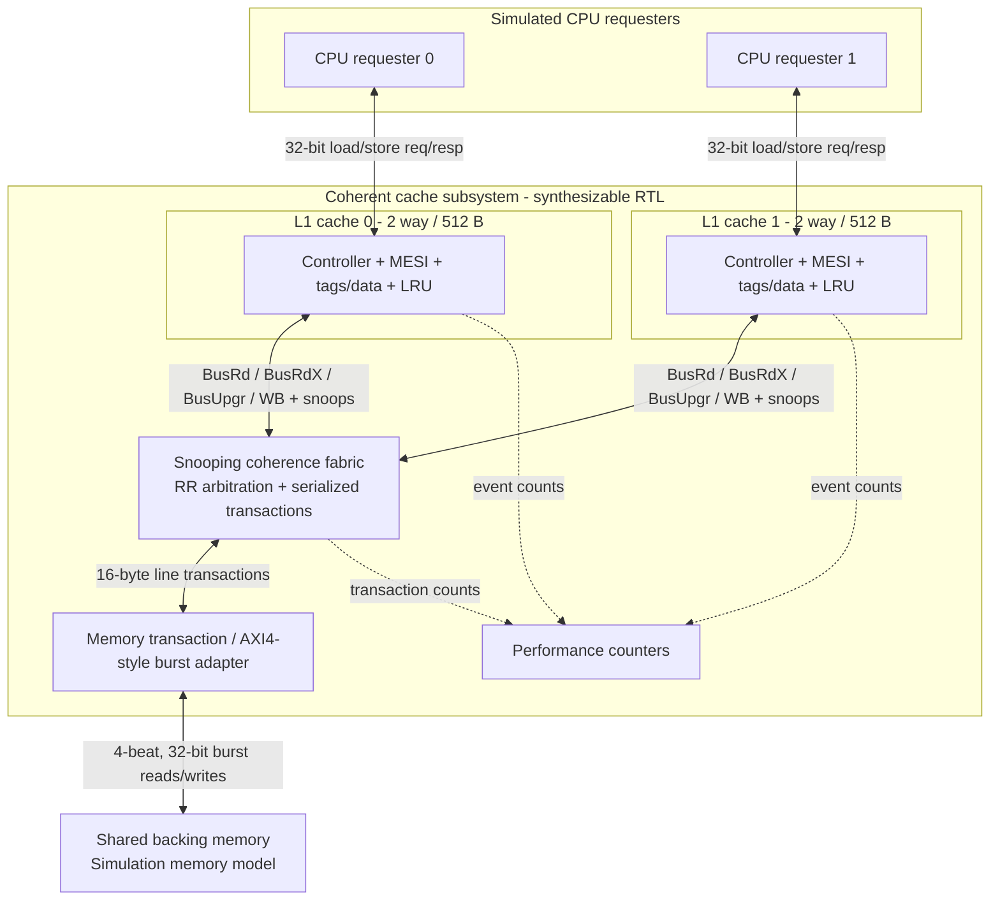
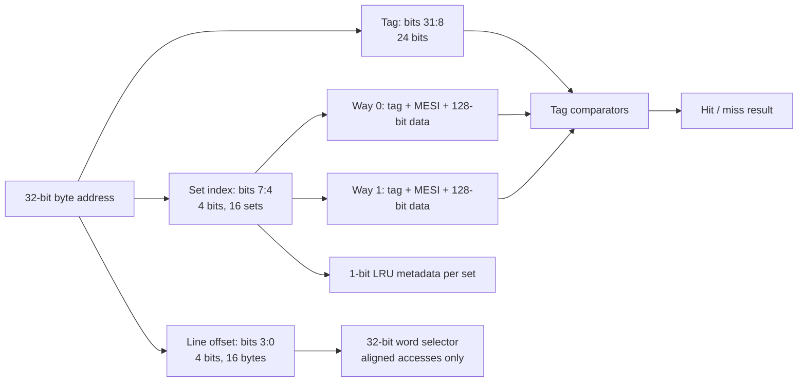

# System Architecture Specification

**Document:** ARCH-001 | **Version:** 0.1 | **State:** Proposed final architecture | **Date:** 2026-10-18

## 1. Purpose and scope

Implement a coherent, dual-L1 data-cache memory subsystem in synthesizable SystemVerilog; verify with a standalone SystemVerilog/UVM environment; synthesize and analyze timing on the Nexys A7-100T. This document defines the **end goal**; implementation phases do not need separate architecture diagrams.

## 2. System block diagram



**Boundary:** the requester and backing-memory model are testbench components during RTL simulation. Both L1 controllers, the snooping fabric and the memory adapter are intended to be synthesizable.

## 3. Configuration and cache organization

| Item | Planned final configuration |
| --- | --- |
| Number of CPUs / caches | Two requesters, two private L1 data caches |
| Address format | 32-bit byte addresses, little-endian data |
| CPU accesses | Aligned 32-bit loads and stores; one outstanding request per CPU |
| L1 associativity | 2-way, 16 sets |
| Line size | 16 bytes = four 32-bit words |
| Cache size | 16 sets × 2 ways × 16 bytes = **512 bytes per L1** |
| Tag | address[31:8], 24 bits |
| Set | address[7:4], 4 bits |
| Byte offset | address[3:0], 4 bits (word-select from bits [3:2]) |
| Replacement | 1-bit true LRU within each 2-way set |
| Write policy | Write-back and write-allocate |
| Coherence | MESI, central snooping and transaction serialization |
| Memory transactions | 16-byte line reads/writes as four 32-bit beats |
| Clock/reset | One synchronous clock domain; synchronous active-low reset (planned) |
| Backpressure | Valid/ready-style handshakes; no dropped accepted request |
| Throughput | One outstanding request per requester; no general-purpose OoO engine |



Cache line metadata per way consists of tag, MESI state and data; one LRU bit is maintained per set. An invalid line is represented by state I, removing the need for an independent valid bit. State and tag update atomically when a fill or snoop completes.

## 4. RTL component responsibilities

| Component | Purpose |
| --- | --- |
| `cache_subsystem_top` | Connect requesters, two cache controllers, coherence fabric and memory adapter |
| `l1_cache` ×2 | Detect hits/misses, update words, allocate/replace lines, respond to CPU requests |
| `cache_tag_data_array` | Store tag, 128-bit data and MESI metadata for 2 ways × 16 sets |
| `lru_controller` | Choose least-recently-used way (when both ways are valid) |
| `coherence_fabric` | Round-robin arbitrate and serialize coherence transactions; broadcast snoops |
| `mesi_controller` | Handle local and snooped state transitions; coordinate dirty flush and invalidation |
| `memory_adapter` | Convert line requests/writebacks to four-beat AXI4-style memory bursts |
| `performance_counters` | Observe hits, misses, dirty writebacks, invalidations and coherence transactions |

The architecture can evolve through module merges/splits without changing the specified externally visible behavior.

## 5. Coherence protocol and ownership

Use MESI cache-line states:

- **M / Modified**: sole cached owner, data differs from backing memory. Must flush before giving ownership away or eviction.
- **E / Exclusive**: sole cached copy, clean. Local write can change E → M without fabric traffic.
- **S / Shared**: clean data, one or both caches may hold it. Local write requires an upgrade and invalidation of other sharers.
- **I / Invalid**: no usable cached copy.

```mermaid
stateDiagram-v2
    direction LR
    [*] --> I: reset
    state "Invalid (I)" as I
    state "Shared (S)" as S
    state "Exclusive (E)" as E
    state "Modified (M)" as M
    I --> E: local read miss; no peer copy (BusRd)
    I --> S: local read miss; peer has copy (BusRd)
    I --> M: local write miss; get ownership (BusRdX)
    E --> M: local write hit (silent)
    E --> S: snooped peer BusRd
    E --> I: snooped BusRdX or eviction
    S --> M: local write hit; BusUpgr / invalidate peers
    S --> I: snooped BusRdX or BusUpgr or eviction
    M --> S: snooped BusRd / writeback first
    M --> I: snooped BusRdX / writeback first
    M --> I: local dirty eviction / writeback
    S --> S: local read hit
    E --> E: local read hit
    M --> M: local read/write hit
    I --> I: unrelated snoop
```



The diagram shows stable line states, not every transient pipeline/controller state. While a snoop/writeback is pending, the fabric must block conflicting line transactions until ownership and memory data are coherent.

### Serialized coherence operations

| Transaction | Origin | Expected effect |
| --- | --- | --- |
| `BusRd` | Read miss | If another valid copy exists, share S; otherwise requester enters E; flush M owner before completing |
| `BusRdX` | Write miss | Invalidate other copies; flush dirty owner if needed; fetch current line and give requester M |
| `BusUpgr` | Write hit in S | Invalidate other S sharers; transition requester S → M without re-fetch |
| `Writeback` | Dirty victim or snoop | Write full 16-byte modified line to backing memory before release/downgrade |

**Snoop responses** must distinguish: no hit, clean hit, modified hit + line data, and completion acknowledgement. When a modified owner is snooped, the fabric saves/flushes the latest data *before* returning the line or issuing ownership to the requester.

Arbitration is round-robin between the two caches; the initial implementation permits one active fabric transaction and one memory burst at a time. Cache-side stall handling is mandatory.

## 6. Sequence: read from a modified peer

```mermaid
sequenceDiagram
    autonumber
    participant R0 as CPU requester 0
    participant C0 as L1 cache 0 (I)
    participant F as Coherence fabric
    participant C1 as L1 cache 1 (M)
    participant A as Memory adapter
    participant M as Shared memory
    R0->>C0: read(address)
    C0->>F: BusRd(line address)
    F->>C1: snoop BusRd
    C1-->>F: hit M + dirty line data
    F->>A: write back dirty 16-byte line
    A->>M: 4-beat write burst
    M-->>A: write response
    A-->>F: writeback complete
    F->>C1: commit M to S
    C1-->>F: snoop complete
    F-->>C0: data + new state S
    C0-->>R0: requested word
    Note over C0,C1: Both caches now hold clean S copies; backing memory is up to date.
```

**Postcondition:** cache 0 and cache 1 both hold Shared copies and memory has the latest value. The result returned to CPU0 must match the most recent completed CPU store.

## 7. Sequence: Shared-to-Modified write upgrade

```mermaid
sequenceDiagram
    autonumber
    participant R0 as CPU requester 0
    participant C0 as L1 cache 0 (S)
    participant F as Coherence fabric
    participant C1 as L1 cache 1 (S)
    R0->>C0: write(address, data)
    C0->>F: BusUpgr(line address)
    F->>C1: snoop invalidate
    C1-->>F: invalidate complete (S to I)
    F-->>C0: ownership granted
    C0->>C0: update word; state S to M
    C0-->>R0: write acknowledged
    Note over C0,C1: Cache 0 is the sole owner; backing memory remains stale until flush.
```

**Postcondition:** cache 0 holds M, cache 1 holds I, and memory may remain stale until the next required writeback.

## 8. Other flows that must be supported

- **Read miss with no peer**: fetch from memory and allocate E.
- **Read miss with clean peer E/S**: fetch clean contents, return S, ensure E sharer downgrades to S.
- **Write miss with peer E/S**: invalidate peer, load line, apply store, allocate M.
- **Write miss with peer M**: obtain/flush latest dirty line, invalidate peer, apply store, allocate M.
- **Dirty eviction**: write back M victim *before* its way is reused.
- **Clean eviction**: evict E/S without memory writeback.
- **Fair contention**: both requesters issue misses simultaneously; round-robin arbiter eventually serves both.
- **Reset**: invalidate all lines and clear pending transactions/counters; do not treat reset as memory persistence/flush.

## 9. Timing and synthesis

Target **Nexys A7-100T / xc7a100tcsg324-1**, with a nominal design goal of **100 MHz** (not a claimed achieved clock). Report actual post-implementation WNS, estimated Fmax, LUTs, FFs and memory resources, and explain critical path. If BRAM inference constrains combinational read timing, architecture may add pipeline stages while preserving ready/valid behavior.

## 10. Explicit exclusions

- No full RISC-V CPU implementation.
- No instruction caches, multilevel L2/L3 or virtual memory/TLB.
- No cache-to-cache DMA, cache maintenance instructions or memory-mapped I/O.
- No speculative loads, out-of-order completion or >1 outstanding request per requester.
- No claim of full general-purpose AXI4 compliance until a separate protocol conformance pass.

## 11. Acceptance principle

An architectural feature is **complete only when implementation, a self-checking test, and evidence (assertions/coverage/waveforms/results)** agree. The documentation is a target specification, not evidence of completion.
