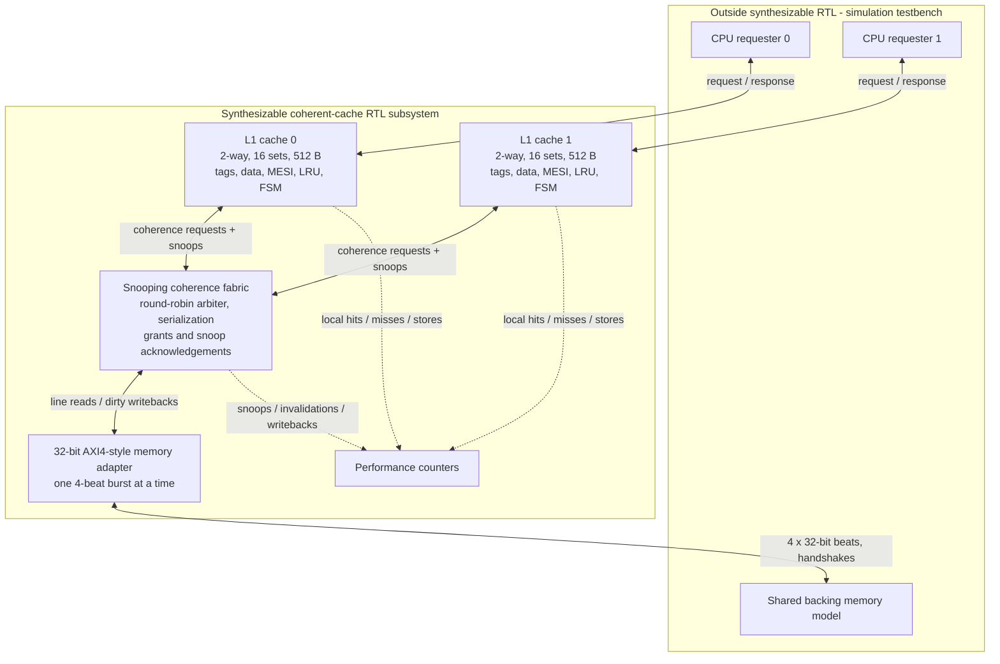
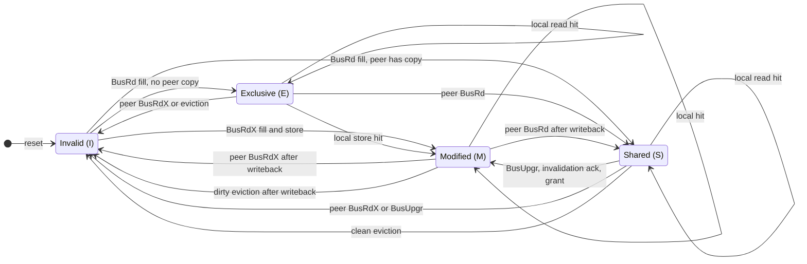

# System architecture

Each simulated CPU gets its own L1 cache. Both caches connect to the same memory through a snooping fabric and an AXI-style adapter.

## Why it's arranged this way

- **Private L1 caches** make nearby data fast for each CPU, but they can end up holding different copies of the same address.
- **The snooping fabric** broadcasts ownership requests to the other cache. It lets only one coherence transaction use the bus at a time so ownership changes have a clear order.
- **The memory adapter** moves a whole 16-byte cache line in four 32-bit transfers. The caches work with lines; the CPUs work with words.
- **Simulated CPUs and memory** let us focus on the cache hardware without building a processor or external RAM controller first.

## MESI states

| State | Meaning |
| --- | --- |
| **M** — Modified | This cache has the only current copy. Memory can be out of date. |
| **E** — Exclusive | This cache has the only copy, and it matches memory. |
| **S** — Shared | Other caches may have the same clean line. |
| **I** — Invalid | The entry cannot supply data. |

**Why MESI?** A cache can write directly when it has **E** or **M**, without sending an ownership request every time. A write to **S** must first invalidate other copies. MESI captures both behaviors without the extra *Owned* state of MOESI.

This is a diagram of the **stable line states**. The controller will also have temporary wait states while a transfer or invalidation is in progress.

See [transaction examples](transaction_examples.md) for an actual read and write exchange between the caches.
