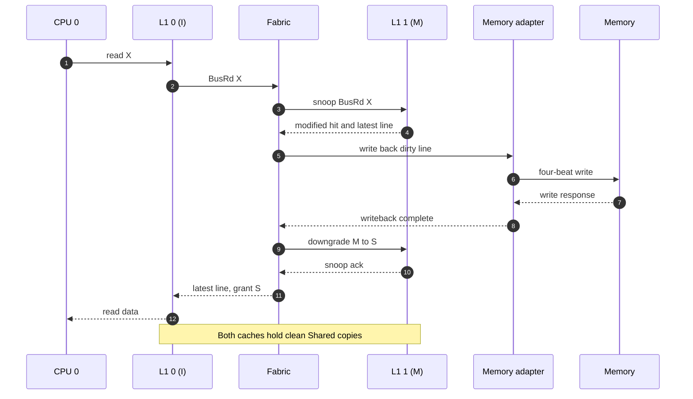
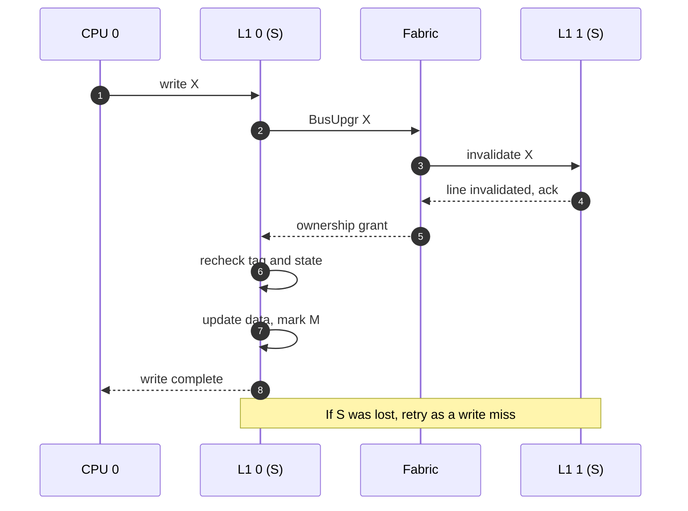

# Cache transactions

These examples show why the two caches need to communicate. `X` means the same cache-line address in both caches.

## Read from a Modified peer

CPU 0 misses on X, but cache 1 has the newest copy in **M**. Reading directly from memory would return old data, so the fabric gets the line from cache 1. In our design, it writes the line back before both caches move to **S**.

**Result:** both caches have a clean Shared copy. Memory now has the updated line. We chose the writeback-before-sharing approach because it is easier to reason about, although it creates extra memory traffic.

## Write to a Shared line

CPU 0 wants to change X while both caches hold it in **S**. It must first ask for exclusive ownership. The fabric invalidates cache 1 and waits for its acknowledgement before granting the write.

**Result:** cache 0 is **M** and cache 1 is **I**. This prevents cache 1 from later reading an old copy as if it were current. Cache 0 rechecks its own tag and state after the grant in case an earlier snoop changed the entry.

Other cases use the same rules: a read with no peer copy fills **E**; a write miss uses `BusRdX`; an evicted **M** line must be written back.
