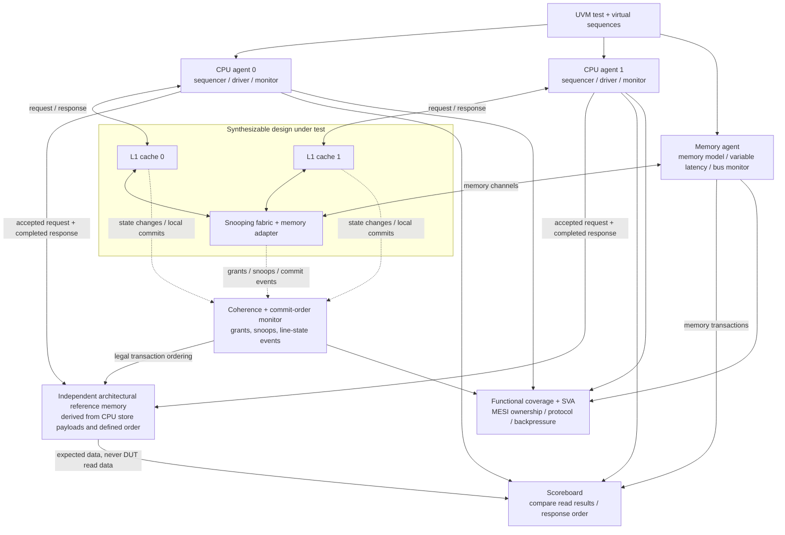

# Verification Architecture and Test Plan

**Document:** DV-001 | **Version:** 0.2 | **State:** Proposed final environment

## 1. Final UVM testbench diagram

The verification environment is **not synthesizable**. `cache_subsystem_top` is the DUT. CPU requester and memory agents form the stimulus and observation environment. Vivado 2025.2's built-in simulator handles early RTL tests; the exact simulator/toolchain for full UVM will be confirmed empirically, rather than assuming a campus license includes a feature.

## 2. Components

- **CPU agents ×2:** configurable sequences, drivers for valid/ready request interface, passive monitors on accepted requests/responses.
- **Memory agent:** backs 32-bit burst transactions with a byte-addressed memory model and configurable stalls/latency; monitors read/write traffic.
- **Independent reference model:** maintains architectural memory values from **observed CPU write payloads**, not DUT returned data or internal arrays; applies writes at defined commit/linearization events and orders conflicting operations using the documented operation history. Accepted requests alone do not imply store completion.
- **Scoreboard:** associates accepted requests with completed responses, checks load values and exactly-once responses, verifies any allowed interleaving respects the observed grant/commit order, and reports the first mismatch with address, expected/actual value, and operation history.
- **Coherence/commit-order monitor:** directly observes coherence requests/grants, snoop acknowledgements, invalidations, dirty writebacks, local store commits and *stable* MESI transitions. Feeds operation order to the reference model and ownership checks. Transient busy states are **not** mistakenly treated as stable MESI pairs.
- **Coverage collector:** samples committed operations, transitions and scenarios, including contention and dirty ownership transfers.
- **SVA:** checks interface stability under backpressure, legal state encodings and no conflicting stable owners.

## 3. Directed scenarios

| Test | Required condition | Main invariant |
| --- | --- | --- |
| Cold miss | First read of a line | Correct memory data; E if no peer |
| Same-line hit | Second read | No unnecessary memory transaction |
| Two-way placement | Two different tags mapping to one set | Both coexist |
| LRU conflict | Read third tag in occupied set | Least recently used way evicted |
| Write allocate | Store to an absent line | Allocate and enter M |
| Dirty replacement | M victim selected | Writeback precedes reuse |
| Exclusive write | Local store to E line | E→M, no snoop request |
| Shared write | Local store to S line | BusUpgr, peer invalidates |
| Remote read from M | Peer has latest dirty line | Dirty writeback, M→S and requester S |
| Remote write from M | Peer M, requester needs ownership | Flush dirty, invalidate peer, requester M |
| Clean sharing | Peer E, second CPU reads | Both S; correct data |
| Concurrent misses | Both CPUs request overlapping/conflicting lines | Arbitration and correct serialized outcomes |
| Concurrent local store + snoop | Prior accepted M/E store races with peer BusRd/BusRdX | Snoop sees most recent committed value; no early ack |
| Upgrade revalidation | S line invalidated while BusUpgr is queued | Stale upgrade is canceled/retried as BusRdX |
| Exclusive collision | Peer has E, second CPU reads/writes | Never E+S or E+M at stable boundary |
| Backpressure | Random pause of request/response/memory channels | Stable payload and progress |
| Reset | Known startup state and controlled reset | All lines I; no stale transaction accepted |

## 4. Functional coverage goals

Cover both requesters, hit/miss, read/write, four stable MESI states, critical MESI transitions, both victim ways, clean/dirty eviction, BusRd/BusRdX/BusUpgr/writeback, peer state on snoop, stall lengths, and simultaneous requests. Cross coverage can include request type × prior MESI state × peer state and eviction dirtiness × replacement way.

Add pair-state invariant bins for `(M,I)`, `(E,I)`, `(S,S)`, `(S,I)`, `(I,I)` and their reversals; explicitly reject all `M + non-I` and `E + non-I` stable pairs. Cross local-store/snoop arrival ordering, grant latency, queued BusUpgr invalidation and writeback completion. The sign-off goal is **all required named scenario bins hit** plus a published percentage for remaining optional bins. No percentage is claimed until measured.

## 5. Assertions / invariants

1. `req_valid && !req_ready` and `resp_valid && !resp_ready` hold payload stable until handshake, absent reset.
2. No port accepts a second CPU operation until the first has produced its response.
3. **M is exclusive:** if one stable cache holds a line in M, the peer's same line is I.
4. **E is exclusive:** if one stable cache holds a line in E, the peer's same line is I. This explicitly forbids **E+S**.
5. **S stays clean:** where stable copies are S/S, both line data values are identical and agree with backing memory.
6. No snoop acknowledgement is issued before a prior accepted same-line store has committed, and a writeback required by M→S/M→I is complete.
7. No store with S/I starting state becomes M or responds before the ownership grant and local data commit; a queued S upgrade invalidated by a prior snoop cannot commit.
8. At most one coherence transaction is granted at a time, and peers receive coherent grant/ack semantics.
9. Exactly one response per accepted CPU operation, absent explicit reset cancellation.
10. Every memory line transfer has exactly four accepted 32-bit beats and proper final-beat indication; stalled memory channel fields stay stable.
11. A snoop can invalidate only its specified 16-byte line address.

Sample stable-pair checks at an architecturally meaningful **quiescent/transaction boundary**, with separate properties for in-flight transient states. See [`coherence_ordering.md`](coherence_ordering.md).

## 6. Regression evidence

Keep seed, simulator version, timestamp, compile command, PASS/FAIL summary, scoreboard total, assertion failures, coverage summary and waveforms for investigated failures. Add a regression script and include actual verified results in README.

## 7. Hardware result evidence

Capture synthesis and implementation reports for the stated target, plus clock constraints and the highest achieved clock under a valid timing closure. Provide results only after running the tools.
