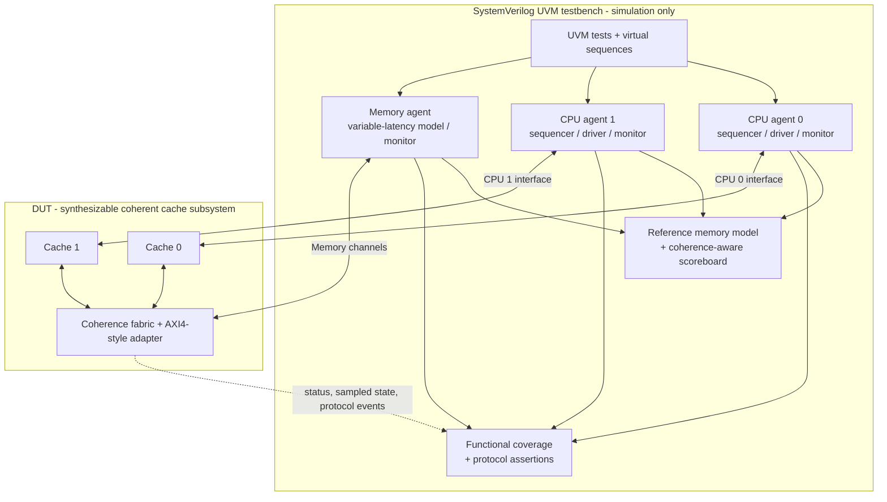

# Verification Architecture and Test Plan

**Document:** DV-001 | **Version:** 0.1 | **State:** Proposed final environment

## 1. Final UVM testbench diagram

The verification environment is **not synthesizable**. `cache_subsystem_top` is the DUT. CPU requester and memory agents form the stimulus and observation environment. Vivado 2025.2's built-in simulator handles early RTL tests; the exact simulator/toolchain for full UVM will be confirmed empirically, rather than assuming a campus license includes a feature.

## 2. Components

- **CPU agents ×2:** configurable sequences, drivers for valid/ready request interface, passive monitors on accepted requests/responses.
- **Memory agent:** backs 32-bit burst transactions with a byte-addressed memory model and configurable stalls/latency; monitors read/write traffic.
- **Reference model:** maintains architectural memory values independently of when dirty data reaches backing memory. Update reference state at accepted/acknowledged stores consistent with transaction ordering.
- **Scoreboard:** associates requests with responses, compares returned loads to reference memory, checks order under serialized coherence operations and reports first failure with address and expected/actual value.
- **Coherence checker:** observes permitted line states / events and enforces invariants; avoid treating speculative/in-flight transients as committed stable states.
- **Coverage collector:** samples committed operations, transitions and scenarios, including contention and dirty ownership transfers.
- **SVA:** checks interface stability under backpressure, legal state encodings and no conflicting stable owners.

## 3. Directed scenarios

| Test | Required condition | Main invariant |
| --- | --- | --- |
| Cold miss | First read of a line | Correct memory data; E if no peer |
| Same-line hit | Second read | No unnecessary memory transaction |
| Two-way placement | Two different tags mapping to one set | Both coexist |
| LRU conflict | Read third tag in occupied set | Least recently used way evicted |
| Write allocate | Store to an absent line | Allocate and enter M |
| Dirty replacement | M victim selected | Writeback precedes reuse |
| Exclusive write | Local store to E line | E→M, no snoop request |
| Shared write | Local store to S line | BusUpgr, peer invalidates |
| Remote read from M | Peer has latest dirty line | Dirty writeback, M→S and requester S |
| Remote write from M | Peer M, requester needs ownership | Flush dirty, invalidate peer, requester M |
| Clean sharing | Peer E, second CPU reads | Both S; correct data |
| Concurrent misses | Both CPUs request overlapping/conflicting lines | Arbitration and correct serialized outcomes |
| Backpressure | Random pause of request/response/memory channels | Stable payload and progress |
| Reset | Known startup state and controlled reset | All lines I; no stale transaction accepted |

## 4. Functional coverage goals

Cover both requesters, hit/miss, read/write, four stable MESI states, critical MESI transitions, both victim ways, clean/dirty eviction, BusRd/BusRdX/BusUpgr/writeback, peer state on snoop, stall lengths, and simultaneous requests. Cross coverage can include request type × prior MESI state × peer state and eviction dirtiness × replacement way.

The sign-off goal is **all required named scenario bins hit** plus a published percentage for remaining optional bins. No percentage is claimed until measured.

## 5. Assertions / invariants

1. A requester cannot accept a new transaction while already owning an uncompleted accepted transaction.
2. When `valid && !ready`, payload and `valid` must remain stable until handshake (unless reset).
3. No *stable committed* cache pair can hold the same line M and any other valid copy.
4. At most one stable E or M owner exists for any given line address.
5. Modified data must be committed to the shared-memory model before a snoop/grant discards or downgrades its owner (with this design's writeback-on-snoop policy).
6. Exactly one acknowledgement/response per accepted CPU request, absent reset cancellation.
7. Only the designated line may be invalidated by a snoop for that line.
8. Memory bursts must transfer exactly 4 beats, proper final-beat indication and aligned addresses.

## 6. Regression evidence

Keep seed, simulator version, timestamp, compile command, PASS/FAIL summary, scoreboard total, assertion failures, coverage summary and waveforms for investigated failures. Add a regression script and include actual verified results in README.

## 7. Hardware result evidence

Capture synthesis and implementation reports for the stated target, plus clock constraints and the highest achieved clock under a valid timing closure. Provide results only after running the tools.
